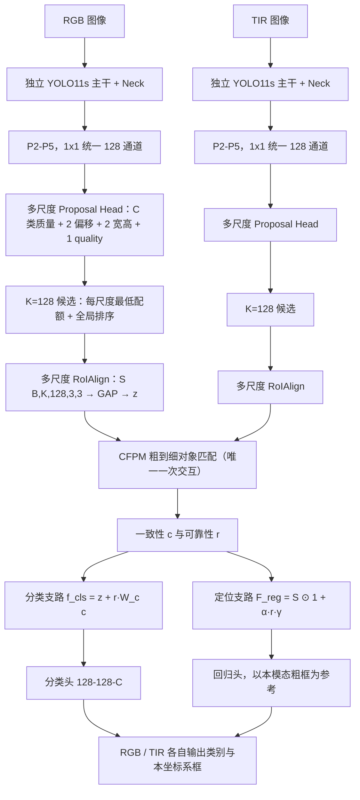

# PGSF-Det：非配准 RGB-T 无人机目标检测

面向 **无需图像配准** 的可见光（RGB）＋红外（TIR）双模态目标检测。四个架构版本（v1–v4）共用同一套数据管线与训练/评估入口，由 `model.architecture_version` 选择前向图。

**当前默认版本：v4 —— 对象级跨模态匹配 + 分类/定位非对称融合。**

> 核心思想：先在目标级动态寻找跨模态对应区域，再按分类与定位对跨模态信息的不同需求做**非对称**融合——
> **分类充分利用跨模态语义，定位始终以本模态空间特征为基础。**

## 版本一览

| 版本 | `architecture_version` | 核心机制 | 状态 |
|---|---|---|---|
| v1 | 1 | 双模态 CNN + 中期稀疏 Transformer + 后期目标 Transformer（含固定仿射先验） | 历史实现，保留可复现（见 `docs/v1_history.md`） |
| v2 | 2 | P2 小目标增强、P2/P3 粗框候选、图像条件概率几何、两次稀疏融合、区域检测头 | 代码完整，可训练（见 `docs/README_v2_archive.md`） |
| v3 | 3 | 128 候选 + 8×8 网格 Token、64 维 Q/K Top-2 检索、锚点高斯局部验证、`z' = z + g(1−p_null)·W_m(m)` 拒绝融合 | 代码完整，可训练（见 `docs/v3.md`） |
| **v4** | **4** | **K=128 候选 + 多尺度 RoIAlign、CFPM 粗到细对象匹配、TD-Fusion 分类/定位非对称融合** | **当前主线（见 `docs/v4.md`）** |

v3/v4 共同的两个结构性决定：**不使用训练集拟合的固定仿射矩阵**、**不做中间特征图写回**；v4 进一步只保留**一次**对象级交互（不再有第二个 Late Transformer）。

## v4 架构



### 关键设计与为什么这样设计

**① CFPM（Coarse-to-Fine Proposal Matching）——只用外观找对应，全程零坐标先验**

- 粗检索：`Q = W_Q·z`、`K = W_K·z_other`，`W_Q, W_K ∈ R^{128×64}`，`A = Q Kᵀ/√64 ∈ R^{B×K×K}`，每行取 **Top-L = 2**。
  相似度是特征的纯函数：**不比较任何中心坐标**（测试把对侧坐标整体平移后断言检索结果不变）。
- 细探测：`OffsetMLP: 256→128→8` 给出 4 个二维偏移，采样位置

  `p = center_il + tanh(Δp_ils) ⊙ size_il`

  其中 **`size` 取自对侧候选框自身**，因此不需要任何相机参数（测试把对侧框放大 2 倍，断言采样位移同步放大 2 倍）。
- 每个采样点预测 P2–P5 的 4 维 softmax 尺度权重并加权采样；2 锚点 × 4 点 = **8 个局部特征** → 注意力聚合得 `z'`。

**② TD-Fusion（Task-Decoupled Fusion）——分类吃语义，定位只吃通道调制**

| 支路 | 公式 | 跨模态信息进入方式 |
|---|---|---|
| 分类 | `f_cls = z + r · W_c(c)` | **加法**：直接吸收跨模态语义 |
| 定位 | `γ = tanh(W_r c)`，`F_reg = S ⊙ (1 + α·r·γ)` | **逐通道缩放**：`γ ∈ R^128` 在空间上是常数场，`S`（本模态 RoI）的空间结构完全保留 |

一致性 Token `c = MLP([z, z', z⊙z', |z − z'|])`（512→256→128）；可靠性门控
`r = sigmoid(MLP([z, z', |z − z'|, q_self, q_other, Top1 − Top2 间距]))`——匹配越明确、局部特征越一致，`r` 越大。

**设计意图（直觉）**：非配准场景下，对侧模态的 **语义**（"这里有个同类目标"）通常可靠，而它的 **空间边界** 会因视差、外参漂移、分辨率差异在真值附近抖动。分类只需要"这团特征属于哪一类"，空间抖动不影响判决；框回归需要"边界在哪"，空间抖动会直接变成框误差。所以 v4 让跨模态信息**只能说哪些通道更重要，不能说往哪儿挪**——这是用鲁棒性换信息量的明确取舍。

**③ 初始化即两个独立检测器**

`W_c`、`W_r` 零初始化 ⇒ 初始化时 `f_cls = z`、`γ = 0 ⇒ F_reg = S`，整个融合是**精确恒等**，两阶段迁移安全
（`test_gate_and_modulation_are_identity_at_initialisation`、`test_v4_stage_transfer_preserves_initial_detection` 均有断言）。

**④ 辅助单模态损失不增加推理分支**

`L_self` 用**同一套检测头**、只把输入换成未融合的 `z_m` / `S_m`，保证"跨模态匹配失败时本模态仍具备完整检测能力"；推理时没有额外分支。

### 损失

```
L = L_final^RGB + L_final^TIR
  + w_self · (L_self^RGB + L_self^TIR)
  + w_prop · (L_prop^RGB + L_prop^TIR)
  + λ_match · L_match
  + w_cons  · L_cons
```

| 项 | 内容 | 默认权重 |
|---|---|---|
| `L_final^m` | `L_QFL + λ_iou·L_CIoU + λ_l1·L_L1`（类别感知，QFL 目标 = 一热类别 × 分配框 IoU） | `λ_iou=2.5`、`λ_l1=1.0` |
| `L_self^m` | 同样三项，输入为未融合的 `z` / `S` | `w_self=0.5` |
| `L_prop` | `L_heatmap + λ_pbox·L_CIoU_coarse + λ_quality·L_quality`（逐尺度、逐类别） | `w_prop=0.5`、`λ_pbox=1.5`、`λ_quality=0.5` |
| `L_match` | `CE(A_RT, target_RT) + CE(A_TR, target_TR)`，**只对确实存在对应的 query 行计算** | `λ_match=1.0` |
| `L_cons` | `JS(p_self ‖ p_other)`，配对来自真实对应，或训练进度 ≥ `cons_start_fraction` 后的双向互选 | `w_cons=0.1` |

- 没有实例对应标注时 `L_match = 0`：缺少 `corr_pairs` 即自动跳过。**禁止**用相同数组下标、类别相同或最近坐标强行构造对应关系——`identity_matches` 实现为"候选 → 本侧 GT 槽 → 对侧 GT 槽"两跳查询，两侧目标数量可以不同。
- `use_match_loss` / `use_cons_loss` 均可关闭；默认关闭 NWD。
- 可调项全部在配置里：`n_cand`(K)、`td_top_l`、`td_samples`、`retrieval_dim`、`alpha_init`、`roi_size`、各损失权重、`num_classes` 等。

## 代码结构

```
pgsf/
├── config.py                 全部配置项（数据/模型/优化/评测）
├── data/uavcb.py             多目标·多类别·异分辨率·两侧数量不同的配对数据管线
├── engine/trainer.py         两阶段训练、DDP、AMP、EMA、早停、评测
├── losses.py                 QFL / CIoU / NWD / 目标分配 / 高斯绘制 / 关联损失
├── models/
│   ├── detector.py           按 architecture_version 分派 v1/v2/v3/v4
│   ├── proposal_v4.py        P2-P5 类别质量头、K=128 跨尺度候选、多尺度 RoIAlign
│   ├── matching_v4.py        CFPM（64 维检索 + Top-L + 局部多尺度采样 + 注意力聚合）
│   ├── fusion_v4.py          TD-Fusion（一致性 Token、可靠性门控、通道调制、可学习 α）
│   ├── head_v4.py            分类头/回归头、解码、DetectionLossV4、JS 散度
│   ├── detector_v4.py        v4 组装、前向与全部损失项
│   ├── proposal_v3.py / correspondence_v3.py / head_v3.py / detector_v3.py    v3 实现
│   └── ...                   v1/v2 实现（backbone / neck / candidate / fusion / late_fusion）
└── utils/                    部署（Conv-BN 融合、CUDA Graph）、GPU 选择、COCO AP 指标、性能剖析
configs/                      v1–v4 各阶段配置（含 v3/v4 的 stage1/stage2）
scripts/                      train.py / train_v3.py / train_v4.py、infer_v4.py、check_forward.py 等
tests/                        v1–v4 行为、数值、梯度与兼容性测试
docs/                         v1_history.md、v3.md、v4.md、README_v2_archive.md、full_training.md
```

## 快速开始

```bash
PY=/home/yangjuanfeng/lab/envs/venv/bin/python     # Python 3.12 / torch 2.5.1+cu121 / torchvision 0.20.1

# 全部测试（v1–v4，共 164 项）
$PY -m unittest discover -s tests -v

# v4 全参数梯度审计（AdamW 下应在数步内全部打开）
V4_DEEP=1 $PY tests/test_v4.py DeepGradientAudit -v

# 前向/反向/形状/显存/延迟体检
$PY scripts/check_forward.py --config configs/pgsf_v4_stage2.yaml --batch 1

# 两阶段训练（2×10GB RTX 3080，AMP，每卡 batch 2）
$PY scripts/train_v4.py --config configs/pgsf_v4_stage1.yaml --gpus 0,1
$PY scripts/train_v4.py --config configs/pgsf_v4_stage2.yaml --gpus 0,1 \
    --ckpt outputs/v4_stage1/ckpt/best.pt

# 评估与推理（推理不需要任何 GT 字段）
$PY scripts/train_v4.py --config configs/pgsf_v4_stage2.yaml --eval-only \
    --ckpt outputs/v4_stage2/ckpt/best.pt --split val
$PY scripts/infer_v4.py --ckpt outputs/v4_stage2/ckpt/best.pt --split val --n 32 \
    --out outputs/v4_val_dets.json
$PY scripts/infer_v4.py --pair /data/a_visible.jpg /data/a_thermal.jpg   # 无 GT、无 checkpoint 也能跑通
```

v1/v2/v3 用 `scripts/train.py --config configs/pgsf_<...>_stage2.yaml`，或同为薄封装的 `scripts/train_v3.py`。

## 已实测数据（RTX 3080 10GB，FP16，batch 1/2）

| 指标 | v3 | v4 |
|---|---|---|
| 参数量 | 13.71 M | 13.77 M（match 0.50 M + td 0.49 M + 两条分支 6.39 M×2） |
| Conv/Linear MACs | — | 41.70 G（按 2×MACs 约 83.39 GFLOPs） |
| 输入 | RGB 800×1280 + TIR 512×640，两模态分辨率独立 | 同左 |
| 峰值显存（batch 1） | 1750.7 MiB | 1742.9 MiB |
| 延迟（batch 1） | 42.81 ms（23.4 FPS） | 35.61 ms（28.1 FPS） |
| 延迟（batch 2） | — | 43.39 ms（23.0 FPS），峰值 3344.2 MiB |
| 梯度覆盖 | 全参数 | 全参数（死参数 86→6→0） |
| 测试 | 134 项通过 | 164 项通过（同一工程内含 v1–v4） |

延迟为 eager PyTorch 的单对 RGB/TIR 前向，**未启用** Conv-BN 融合与 CUDA Graph；不计磁盘读取、JPEG 解码与显示。
（上述数字为实测值，不是全体数据集平均吞吐。）

## 数据与评测协议

- 默认数据集 **UAV-CB**（3393 对原始图像、5 个场景，每模态单目标；RGB 1920×1080 / TIR 640×512，**两模态未配准**）。
- 固定划分清单 `dataset/UAV-CB/splits/{train,val,test}.txt`（本地按论文 6:2:2 规则重建，排除 10 对坏样本；train 2028 / val 678 / test 677）。缺失清单时回退到内部序列级划分，**正式实验不可混用两套划分**。
- 框统一为各模态自身归一化 `cx,cy,w,h`；推理输出各自原图像素 `xyxy`；指标为 RGB/TIR 分开的 AP50、AP75、101 点插值 AP50:95 与小目标召回。
- 训练集用于拟合与统计，验证集用于选模型，**测试 GT 不参与训练与模型选择**。
- 多目标 / 多类别支持：每模态各自 `boxes_*`、`mask_*`、`labels_*`；实例对应矩阵 `corr_pairs` 只在对应关系无歧义（两侧各一个目标）或显式 `data.pair_by_index=true` 时给出，否则只计算两模态检测损失。

## 当前进度与已知限制

- ✅ v4 代码、配置、训练/推理入口、测试、文档齐备；164 项测试通过；GPU 上前后向、显存、延迟已实测。
- ✅ 推理阶段不读 GT、不做 GT 候选注入、不读固定仿射先验（均有对应测试）。
- ⚠️ **尚未完成 v3/v4 的全量两阶段训练与正式验证/测试集评估**，因此**没有** v4 与其他版本的性能对比数字。本仓库当前交付的是"可运行、可审计、被测试覆盖"的实现，不是"已证明更强"的结果。
- ⚠️ 多目标 / 多类别路径目前只在合成数据与单元测试层面验证（UAV-CB 每模态单目标）。
- ⚠️ v4 的定位支路在结构上**拒绝**对侧空间信息：当对侧模态确实能提供可靠空间修正时，这一约束会限制上限——它是为非配准场景的鲁棒性所付的代价。

## 引用与文档

- 架构细节与设计取舍：`docs/v4.md`（v4）、`docs/v3.md`（v3）、`docs/v1_history.md`（v1/v2 历史与旧数字）。
- v2 时期的 README（含 2026-10-10 的训练诊断记录）：`docs/README_v2_archive.md`。
- 数据格式、划分规则与增强说明：`pgsf/data/uavcb.py` 顶部注释。
