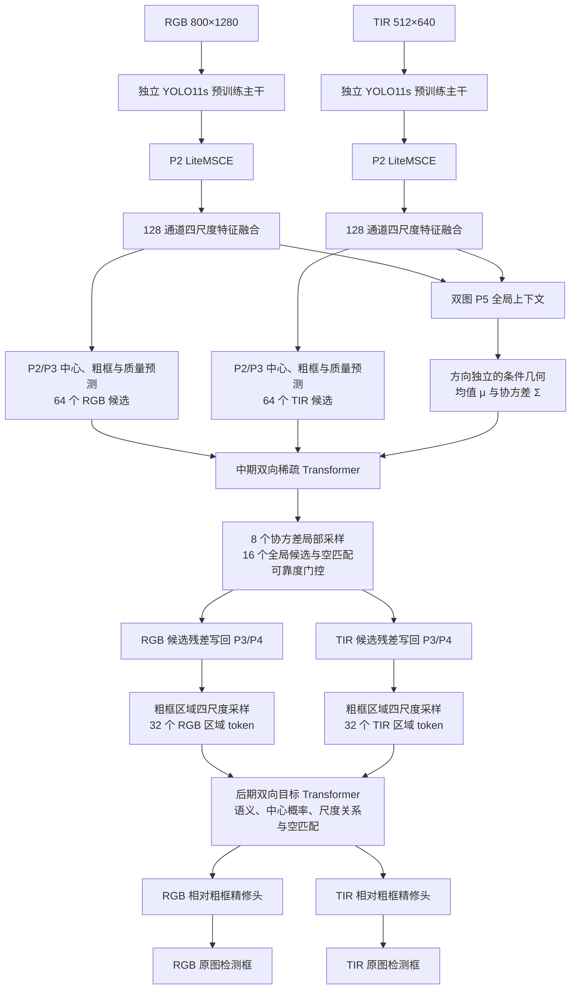

# PGSF-Det v2：非配准 RGB-T 无人机检测

当前默认配置已切换到 v2：独立预训练 CNN、P2 小目标增强、P2/P3 粗框候选、图像条件概率几何、两次稀疏跨模态融合和独立区域检测头。目标是在 UAV-CB 上提高检测精度，同时满足 RTX 3080 的实时双模态推理需求。

2026-10-10 训练诊断发现候选质量反馈问题：候选按热力图乘粗框质量筛选，会在质量
低估真实目标、GT 注入结束后丢失正候选。现已改为 P2/P3、分区候选和后期 top-k
均按中心 objectness 筛选；粗框质量仍接受监督并作为融合证据，最终检测分数仍为
精修质量分数乘 objectness 的平方根。8 张验证帧同一 checkpoint 的候选覆盖对照见
`outputs/metric_collapse_diagnosis/summary.json`；此项不是全验证集性能评估。

2026-10-10 全量训练配置与独立 uv 环境已准备：GPU0/GPU7 DDP、40+160 轮预算、早停30，真实双卡吞吐选择每卡 batch8（总16）。运行状态与详情见 [全量训练说明](docs/full_training.md) 和 `outputs/fulltrain_20261010_200e/status.json`。新训练控制和增强回归共 88 项通过。

已完成架构修改、GPU7 调试、真实训练帧小样本测试和速度测量。**尚未完成全量两阶段训练、正式验证/测试集性能评估和 A0–A6 性能消融；当前 checkpoint 只用于小样本调试。**

## 当前架构



两路主干与检测头权重独立，不进行图像强制配准。网络用训练集中心拟合归一化仿射关系，再由候选、粗框和两张图的上下文预测逐候选残差与正定协方差。RGB→TIR 和 TIR→RGB 各有独立残差与不确定性网络，避免强迫逐帧非线性误差严格互逆。

中期局部采样包含中心和 7 个不同方向参考点，采样范围由协方差控制，并从 P2/P3 取证据。无效局部位置被屏蔽，几何偏置有界，全局候选不受局部几何约束，允许先验失效时回退到全局或空匹配。两方向同时读取原特征，随后各自在自身坐标系写回 P3/P4；重叠候选按权重归一化，AMP 下散射使用 FP32 累加。

后期 token 实际包含粗框区域的四尺度特征，最终检测损失可以直接训练区域提取模块。框回归以粗框中心和尺寸为基准：中心在粗框半尺寸范围内精修，宽高使用有界指数残差。后期匹配同时考虑区域语义、中心分布和学习到的对数尺度关系，不强制一一配对。两次 Transformer 的残差输出均零初始化，阶段迁移时保留阶段一检测行为。

### 特征维度与计算量

默认预训练 YOLO11s 使用原生通道，以完整复用其主干权重；它与最初自定义 CSP 主干的通道表不同。

| 层级 | RGB 主干输出（B=1） | TIR 主干输出（B=1） | Neck 输出通道 |
|---|---|---|---|
| P2 | 128×200×320 | 128×128×160 | 128 |
| P3 | 256×100×160 | 256×64×80 | 128 |
| P4 | 256×50×80 | 256×32×40 | 128 |
| P5 | 512×25×40 | 512×16×20 | 128 |

参数量 **13,920,427（13.92 M）**。完整双模态 Conv/Linear MACs **41.48 G**，按 2×MACs 约 **82.95 GFLOPs**；该计数不包含注意力矩阵乘法、采样、归一化和后处理，不能替代实测 FPS。

TIR 首层卷积由 RGB 预训练首层权重沿输入通道求和初始化。两路分别加载本地权重后独立训练。主干初始化路径为 `/home/yangjuanfeng/lab/shared/weights/yolo11s.pt`，不会自动下载；没有该文件时可显式设 `model.backbone_weights=''` 使用随机初始化，或配置 `model.backbone_name=lightcsp`。

## 监督与训练

- P2/P3 热力图均用中心高斯标签和 CenterNet 焦点损失监督；两尺度粗框在量化后的真实中心接受 CIoU 与可选 NWD 监督。
- 候选质量以粗框 IoU 为监督；最终检测分类使用质量焦点损失 QFL，正目标为精修框 IoU，背景为 0。最终分数为 `sigmoid(final_logit) × dense_objectness^0.5`，定位与排序同时学习。
- 条件几何用配对目标中心的高斯 NLL 监督；尺度关系用目标宽高的对数尺度 NLL 监督。负 NLL 是合法密度值，参考常数不改变梯度。
- 关联损失使用两模态同一 GT 索引构建正匹配；无对应目标或对侧模态不可用时监督空匹配。困难背景与正目标分别平衡，并使用候选置信度加权。
- 训练候选注入仅针对有效 GT，全局回退候选排除注入项；注入比例在训练进度 70% 前衰减至 0。推理完全使用预测候选，不需要 GT 字段。
- 阶段一训练独立分支；阶段二增加融合，主干学习率为基准的 0.1 倍，融合与图像上下文模块为 2 倍。支持 AMP、EMA、权重保存、优化器与 AMP 状态恢复。
- 阶段二含独立空间平移、模态退化和单侧模态丢弃。已知增强矩阵同步更新框与几何关系；丢弃模态屏蔽其检测与几何监督，并保留空匹配监督。未知测试错位不应伪装成已知增强传入模型。

## GPU7 上的实测验证

日志和 JSON 位于 `outputs/v2_validation/`，修改前源码位于该目录的 `source_before/`。

- **83 项单元/回归测试通过**，覆盖原有 v1 与新增 v2，包括 ROI 梯度、独立方向几何、错先验全局回退、模态缺失、阶段迁移、50 token 扩展、GPU AMP 和 CUDA Graph 新输入回放。
- 默认完整输入尺寸随机前向、反向以及 3 步优化后梯度审计通过：**441 个可训练参数张量均有非零、有限梯度**，28 条关键模块路径被损失覆盖。
- 真实数据集的 2 个训练帧、2 个验证帧已通过两阶段训练、验证、迁移、保存和恢复集成测试，两个阶段均 `skipped=0`。短流程验证 AP 为 0，此项不用于性能评价。

### 4 个真实训练帧的小样本测试

仅使用 building/cloud/ground/powerline 的 4 个训练帧，评估时关闭 GT 注入。最初 400 步测试暴露 RGB 置信度排序问题，随后修正 QFL、候选负样本分配和分数融合。修正测试从初次运行保留的 step300 checkpoint 继续训练 400 步，使用 AdamW、batch2、lr1e-4、余弦衰减。

| 修正测试位置 | RGB AP50 | TIR AP50 | RGB AP50:95 | TIR AP50:95 |
|---|---:|---:|---:|---:|
| step100：保存的最佳小样本 checkpoint | 0.7525 | 1.0000 | 0.3277 | 0.5634 |
| step400：最终结果 | 0.5421 | 1.0000 | 0.4077 | 0.7948 |

测试通过脚本的双模态 AP50>0.5 最低门槛，但 **RGB 尚未充分过拟合，且排序/召回有波动**。这些数值只证明监督链路可训练，不能当作验证集、测试集、消融或 SOTA 成绩。保存的 `overfit_refined.pt` 选择依据是这 4 帧的双模态平均 AP50，不是正式最佳模型。

### RTX 3080 速度

Batch1、FP16、RGB800×1280+TIR512×640，Conv/BN 合并。速度单位是一对 RGB/TIR 的完整双路检测，不是单张图。最终速度见 `benchmark.json` 和 `benchmark_graph.json`。

CUDA Graph 固定尺寸、同一对真实图像重复 100 次测量、20 次预热的结果（不是整个数据集的平均吞吐）：

| 测量范围 | 平均延迟 | 双模态 FPS |
|---|---:|---:|
| 前向 + 固定形状框/分数解码 | 11.41 ms | 87.65 |
| 前向 + 解码 + 两路 NMS | 12.22 ms | 81.84 |
| 解码后的 CPU uint8 图像 → GPU 传输/预处理 → 检测/NMS | 13.78 ms | 72.59 |

第三项峰值 allocated 显存约 **244 MiB**，不包含 CUDA 驱动、其他进程及 allocator reserved 内存。磁盘读取、JPEG 解码、显示和结果传回 CPU 不在测速范围内。GPU 预处理用带抗锯齿的 bilinear resize，训练/评测用 PIL resize，插值存在细微差别；该测速没有验证部署预处理的 AP。

CUDA Graph 保留全部模块与候选预算，减少大量小算子的 CPU 启动开销。普通 eager PyTorch 的速度明显更慢；要使用上表性能，必须启用固定形状捕获，不能仅使用 `model.eval()`。

## 环境与运行命令

已验证环境：Python3.12，PyTorch2.5.1+cu121，Torchvision0.20.1+cu121，Ultralytics8.4.154。依赖见 `requirements.txt`；安装 Torch/Torchvision 时选择配套的 CUDA build。

```bash
cd /home/yangjuanfeng/lab/projects/SkyGuard-RGBT/repo/code/PGSF-Det
PY=/home/yangjuanfeng/lab/envs/venv/bin/python
export CUDA_VISIBLE_DEVICES=7
export OMP_NUM_THREADS=4
export MKL_NUM_THREADS=4

# 单元测试、完整输入前后向、真实两阶段训练集成
$PY -m unittest discover -s tests -v
$PY scripts/check_forward.py --config configs/pgsf_stage2.yaml --batch 1 --skip-latency
$PY scripts/check_training.py

# 真实训练帧过拟合；这是调试任务，不是正式性能实验
$PY scripts/overfit_test.py --config configs/pgsf_stage2.yaml \
    --n 4 --steps 400 --batch 2 --lr 1e-4 \
    --ckpt outputs/v2_validation/overfit_4frames.pt \
    --out outputs/v2_validation/overfit_refined.json \
    --save-ckpt outputs/v2_validation/overfit_refined.pt

# 普通推理和固定形状 CUDA Graph 推理测速
$PY scripts/benchmark.py --ckpt outputs/v2_validation/overfit_refined.pt \
    --iters 100 --warmup 20
$PY scripts/benchmark.py --ckpt outputs/v2_validation/overfit_refined.pt \
    --cuda-graph --iters 100 --warmup 20 \
    --out outputs/v2_validation/benchmark_graph.json

# 正式训练配置；尚未执行完整训练
$PY scripts/train.py --config configs/pgsf_stage1.yaml
$PY scripts/train.py --config configs/pgsf_stage2.yaml \
    --ckpt outputs/pgsf_v2_stage1/ckpt/best.pt

# 同阶段恢复训练
$PY scripts/train.py --config configs/pgsf_stage2.yaml \
    --resume outputs/pgsf_v2_stage2/ckpt/last.pt

# 验证集评估、可视化、消融配置生成
$PY scripts/train.py --config configs/pgsf_stage2.yaml --eval-only \
    --ckpt outputs/pgsf_v2_stage2/ckpt/best.pt --split val
$PY scripts/visualize.py --config configs/pgsf_stage2.yaml \
    --ckpt outputs/pgsf_v2_stage2/ckpt/best.pt --split val --n 8
$PY scripts/make_ablation.py --out-dir configs/ablation_v2
$PY scripts/count_params.py --config configs/pgsf_stage2.yaml
```

命令行覆盖示例：`--set optim.batch_size=2 model.use_late_fusion=false`。GPU7 通过 `CUDA_VISIBLE_DEVICES=7` 映射为进程内 `cuda:0`。此次只在 GPU7 上调试；没有进行多 GPU 吞吐实验。

### 代码中启用部署加速

```python
import torch
from pgsf.utils.deploy import fuse_for_inference, CudaGraphForward

# trained_model 已加载 v2 权重；example 的四个字段都是 CUDA Tensor。
# example = {'rgb': RGB输入, 'tir': TIR输入,
#            'rgb_hw': RGB原图H/W, 'tir_hw': TIR原图H/W}
model = fuse_for_inference(trained_model)
model.forward = CudaGraphForward(model, example, decode=True)
with torch.inference_mode():
    detections, raw = model.inference(example, score_thr=0.05)
```

捕获只支持固定输入键、shape、dtype、device 和不变的 eval 权重。新图像会复制到静态缓冲后回放；返回的 `raw` 张量在下一次回放时会被覆盖，需要长期保留时先 clone。阈值/NMS 在图外执行，可逐次调整；输入尺寸或模型权重变化后应重新捕获。

## 数据与评测协议

本地 UAV-CB 为 3393 对原始图像、5 个场景，每模态单目标；默认加载现有划分：

`/home/yangjuanfeng/lab/projects/SkyGuard-RGBT/data/splits/uavcb/{train,val,test}.txt`

这是排除 10 对坏样本后的本地 6:2:2 规则重建版（train2028/val678/test677），**不能直接宣称为已验证的官方划分**。缺少固定 manifest 时，数据模块提供内部序列级划分；正式实验不能混用两种划分。训练集用于拟合先验，验证集用于选择模型，测试 GT 不参与训练、先验拟合和模型选择。

框在模型内统一为各模态自身的归一化 `cx,cy,w,h`；推理输出各自原图像素 `xyxy`，评测 GT 也使用同模态原图像素坐标。填充框与模态无效框被排除。指标提供 RGB/TIR 分开的 AP50、AP75、101 点插值 AP50:95、小目标召回率和双模态检测配对成功率。配对成功率不是注意力匹配准确率。

默认保留每模态最多 32 个区域 token，`eval.max_det=50` 是输出上限；要支持 50 个实际输出候选，设 `model.n_cand_late=50`。已有前向回归测试验证 50 token，但 UAV-CB 标注解析仍服务于其单目标格式，没有真实多目标训练验证。单目标 top1 协议可设 `eval.max_det=1`；正式 SOTA 比较前必须让 baseline 与本模型使用相同划分、输出数量、输入尺寸和 AP 实现。

## 消融与兼容性

A0–A6 的 MSCE、中期融合、几何、门控/空匹配、后期融合、NWD 开关均可独立配置。A0–A3 关闭空匹配，A4–A6 开启；另外可关闭图像上下文、协方差采样和 ROI token 做 v2 内部消融。目前交付的是开关、测试和配置，**没有完整性能消融结果**。

`architecture_version=1` 保留旧实现供回归比较。v1 整模型 checkpoint 无法直接加载到 v2；v2 从本地 YOLO11s 初始化后重新训练，两阶段分支结构相同的 checkpoint 才能严格迁移。旧日志和参数/性能数字见 `docs/v1_history.md`，它们不代表当前版本。

主要代码：`pgsf/models/detector_v2.py`（组装与损失）、`proposal.py`（粗框与候选）、`fusion_v2.py`（概率几何与双向融合）、`pgsf/data/uavcb.py`（增强与标注）、`pgsf/utils/deploy.py`（推理加速）、`tests/test_v2.py`（行为与梯度测试）。
