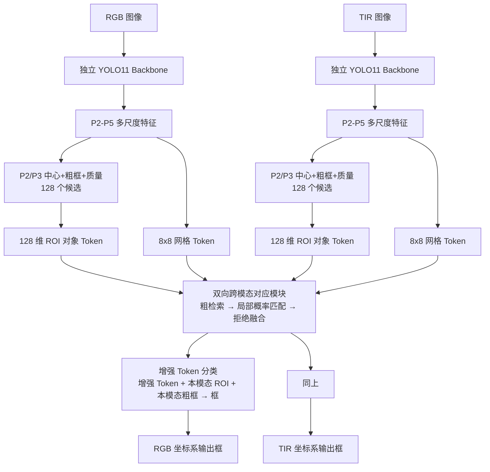

# PGSF-Det v3：对象级跨模态对应 + 拒绝门控融合

`architecture_version=3`。相对 v2 的核心变化只有一句话：**两模态先各自独立检测，
再按当前图像动态寻找跨模态对应目标，只融合可信信息，最后在各自坐标系里独立回归框。**

## 数据流



## 跨模态对应模块（三步）

### 1. 粗检索（无仿射、无坐标距离）

每个对象 Token 用 **64 维 Q/K 点积**在对侧 `128 个候选 Token + 8×8 = 64 个网格 Token + 1 个 Null Token`
中打分，取分数最高的 **Top-2 个真实 key** 作为锚点（Null 参与同一个 softmax，但不会被选为锚点）。

关键点：

* 检索只依赖特征，**不读任何坐标**。`tests/test_v3.py::test_topk_anchors_are_retrieved_by_appearance_only`
  把对侧坐标整体平移 0.3 后断言 `anchor_idx` 完全不变。
* **不使用训练集拟合的仿射矩阵**。v2 的全局仿射在 v3 里被冻结且永不参与前向，
  `test_fitted_affine_has_no_effect_on_v3_predictions` 把 `_affine_A` 改成任意值后断言输出逐比特一致。

### 2. 局部概率匹配

每个锚点预测一个二维高斯 `N(mu, Sigma)`：`mu` 是"可能对应的位置"，`Sigma` 是位置不确定性。
**`Sigma` 直接决定采样位移**（`displacement = L @ reference_ring`），所以不确定的锚点会自动在更大范围试探，
而不是永远送同一圈固定偏移。

每个高斯采 **8 个点**，按 2 个一组分配到 P2/P3/P4/P5，因此每个对象共 **16 个**探测点。
这些点上的局部特征进入注意力做进一步验证，几何先验为

```
logN(sample; mu, Sigma) - logN(mu; mu, Sigma)   (<= 0, 再乘 lambda_local * conf)
```

`Sigma = B Bᵀ + floor² I` 用解析闭式 Cholesky 构造（不调用 `linalg`）：
对任意网络输出都严格正定，且前向不分配 cuSOLVER 工作区，保持 CUDA Graph 可捕获。

### 3. 拒绝融合

```
z' = z + g * (1 - p_null) * W_m(m)
```

`g` 是门控，`p_null` 是"该对象在对侧没有对应目标"的概率，`W_m` **零初始化**。
因此：

* 初始化时 `z' = z`，网络退化为纯单模态检测（阶段迁移安全）；
* 匹配不可靠（`p_null → 1`）或对侧目标缺失时，融合自动关闭——**错误融合严格比不融合更差**。

`p_null` 由 `[z, message, evidence]` 预测，`evidence = [平均置信度, 注意力熵, 检索 Top1-Top2 间距]`。

## 最终检测头

* **分类**：只用增强后的对象 Token。
* **框回归**：输入 = 增强 Token + **本模态** ROI 空间特征（P2-P5 环绕采样）+ **本模态**粗框。
  框塔零初始化，解码为 `center = base + tanh(d)·base_size/2`、`size = base·exp(clamp(d,-2,2))`，
  初始即等于粗框。
* 对侧框**不是**任何输入，因此"复制对侧框"在结构上不可达。
  `test_heads_read_only_their_own_modality` 断言：①每个头是其自身模态张量的纯函数；
  ②融合只改 Token、不改粗框基准；③两路 Token 相互独立。
* 多类别：输出 `4 + num_classes` 通道。`num_classes=1` 与 v1/v2 的单 logit sigmoid 头逐比特等价；
  `num_classes>1` 时解码返回各类 logit 的 argmax。

## 相对 v2 移除了什么

| v2 | v3 |
|---|---|
| 训练集拟合的全局仿射先验 `P(p_T\|p_R)` | 无（改用学习到的外观检索 + 逐锚点不确定性） |
| 中期融合 + **特征图写回**（scatter 到 P3/P4） | 无写回，只增强对象 Token |
| 第二次 Late Transformer | 无，只保留这一次对象级融合 |
| 32 个区域 Token | 128 个候选 / 对象 Token |
| 单 logit 分类头 | 单/多类别统一（`4 + num_classes`） |

`_affine_A` 仍注册以兼容旧 checkpoint，但已 `requires_grad_(False)` 且不参与前向；
`PGSFDet.set_affine` 在 v3 下是显式的 no-op，训练器也不再拟合仿射。

## 监督

| 项 | 由什么监督 |
|---|---|
| 检测（两模态各自） | 候选↔GT 分配的质量焦点分类 + CIoU(+NWD) 框回归 |
| 候选粗框/质量 | P2/P3 量化中心处的 CIoU(+NWD)、候选框 IoU |
| 中心热力图 | CenterNet 高斯标签 + penalty-reduced focal |
| `corr_null` | 该对象在对侧是否存在对应目标（存在则要求注意力落在真实 key 上，否则落在 Null） |
| `corr_retr` | 粗检索：对应目标必须在 softmax 中赢出（这一项才让 Q/K 投影有梯度） |
| `corr_geo` | 锚点高斯 NLL，目标是对侧同身份目标中心 |

后三项**只在 batch 提供实例对应 `corr_pairs` 时计算**；否则目标函数自动退化为两条检测损失
（`terms['corr'] == 0`）。这正是"没有实例对应标注时不臆造匹配监督"的实现。

## 数据管线契约

`PGSF/data/uavcb.py`：

* `list_frames` 采集**全部**标注框（旧版只保留第一个），标签不在 `data.class_names` 里的目标被**丢弃**
  （不静默改映射到 0 类），框与标签一起过滤，永不脱节。
* `PairAugment.augment_boxes` 支持任意目标数（两侧数量可不同）；越界目标（可见面积 < 50%）
  连同其标签一起删除；几何变换对两侧独立记录。
* `UAVCBDataset` 每模态输出 `boxes_*`(M,4) / `mask_*`(M) / `labels_*`(M, int64)，
  原生分辨率写在 `rgb_hw`/`tir_hw`，像素框按**各自模态**的原生尺寸换算。
* `corr_pairs`(M,M) 只在对应关系**无歧义**时给出：两侧各一个目标，或显式打开
  `data.pair_by_index`（UAV-CB 单目标场景下这是精确事实而非假设）。多目标且无配对标注时
  不输出该键 → 匹配/几何损失不计算。

## 配置与运行

```bash
PY=/home/yangjuanfeng/lab/envs/venv/bin/python
cd /home/yangjuanfeng/lab/projects/SkyGuard-RGBT/pgsf-det

# 单元/回归测试
$PY -m unittest discover -s tests -v
# V3 梯度审计（全参数都要有非零梯度）
V3_DEEP=1 $PY tests/test_v3.py DeepGradientAudit -v
# 前向/反向/形状/显存/延迟体检
$PY scripts/check_forward.py --config configs/pgsf_v3_stage2.yaml --batch 1

# 两阶段训练（2×10GB RTX 3080，AMP 开，每卡 batch 2）
$PY scripts/train_v3.py --config configs/pgsf_v3_stage1.yaml --gpus 0,1
$PY scripts/train_v3.py --config configs/pgsf_v3_stage2.yaml --gpus 0,1 \
    --ckpt outputs/v3_stage1/ckpt/best.pt

# 评估 / 推理（推理不需要任何 GT 字段）
$PY scripts/train_v3.py --config configs/pgsf_v3_stage2.yaml --eval-only \
    --ckpt outputs/v3_stage2/ckpt/best.pt --split val
$PY scripts/infer_v3.py --ckpt outputs/v3_stage2/ckpt/best.pt --split val --n 32 \
    --out outputs/v3_val_dets.json
$PY scripts/infer_v3.py --ckpt outputs/v3_stage2/ckpt/best.pt \
    --pair /data/a_visible.jpg /data/a_thermal.jpg --out outputs/v3_pairs.json
```

`optim.batch_size` 现在由配置决定，`scripts/train.py` 不再把它写死为 8
（v3 配置给的是 2，匹配 10GB 卡）。若显存不足优先降 `optim.batch_size`，
其次降 `data.rgb_size`；`corr_samples` / `n_cand` 主要影响算力而非显存。

## 消融开关（v3 内）

| 开关 | 作用 |
|---|---|
| `use_v3_fusion=false` | 退化为纯独立检测（v3 版 A0） |
| `corr_top_k=1` | 单锚点，去掉 Top-2 的备用对应 |
| `use_null=false` | 去掉 Null 竞争与拒绝融合的 `p_null` |
| `use_gate=false` | 去掉门控 `g`（只留 `1 - p_null`） |
| `retrieval_dim` | 64 → 其他维度，检验检索容量 |
| `num_classes` | 单/多类别头 |

## 已验证的失败模式（都是本地测试先抓到的真实缺陷）

1. 多目标框拼接：`np.r_[a, b]` 把两个 `(k,2)` 半框堆成 `(2k,2)`，多人场景下框数组直接错位。
   已改为沿最后一维 `np.concatenate`。
2. 锚点高斯输入维度：写成 `3*dim`，实际是 `2*dim+3`。
3. 采样参考点按 `per_level` 生成，导致按层切片时 P4/P5 落到空切片（张量 size 0）。
   应按 `samples`（8）生成，再按层切分。
4. 身份匹配用候选下标直接索引 `corr_pairs`（尺寸 50 vs 128 冲突），且隐含"候选顺序=标注顺序"的假设。
   已改为"候选 → 本侧 GT 槽 → 对侧 GT 槽"两跳查询。
